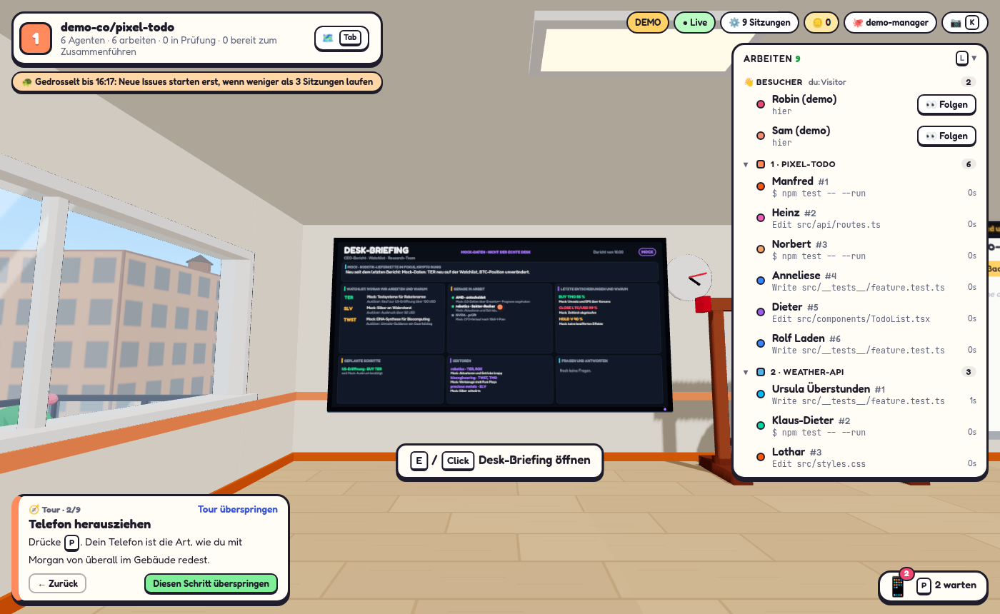
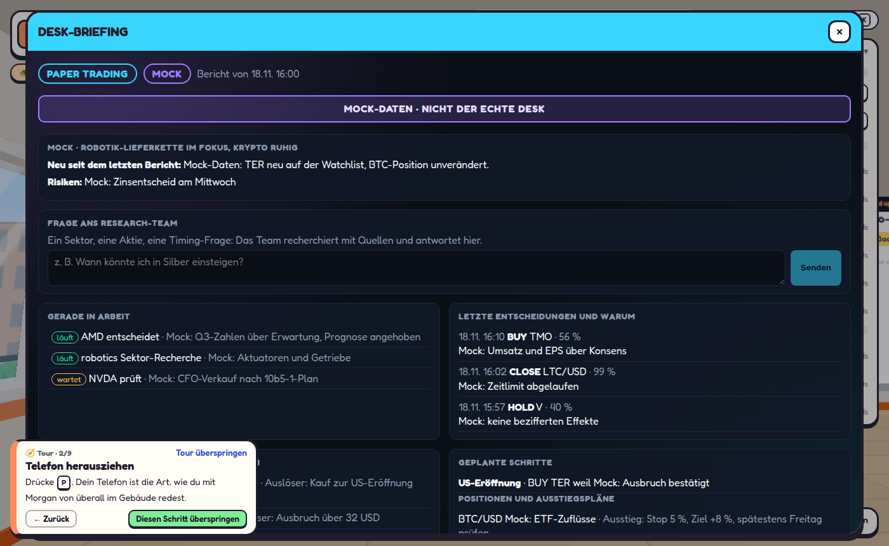

# Desk-Briefing-Tafel

Auf der Trading-Etage hängt an der Nordwand, links vom Gong (anstelle von App-Monitor und Pflanze), die **Desk-Briefing-Tafel**.
Sie zeigt MoneyPrints stündlichen **CEO-Bericht**:

- was sich seit dem letzten Bericht geändert hat,
- die Watchlist mit Begründung und Auslöser,
- die geplanten Schritte mit Zeitpunkt und Grund,
- die offenen Positionen mit ihrem Ausstiegsplan,
- die Sicht je Sektor (Robotik, Bioengineering, Edelmetalle),
- was die Agenten gerade bearbeiten und ihre letzten Entscheidungen mit Begründung,
- die letzte Frage ans Research-Team.

`E` (oder ein Klick) öffnet das Panel mit allem im Detail. Dort stellt der Manager dem Research-Team Fragen, zum Beispiel
„Wann könnte ich in Silber einsteigen?“. Das Team recherchiert mit Quellen und antwortet mit Urteil, Einstiegs- und
Ausstiegsplan, Signalen und Risiken. Genannte Symbole kommen auf die Watchlist.

| Wand (Demo, Mock-Daten) | Panel |
| --- | --- |
|  |  |

## Datenfluss

```
MoneyPrint /briefing.json (nur lesend)  ──GET alle 60 s──►  server/briefing.ts  ──/ws `briefing`──►  Tafel + Panel
Panel „Senden“  ──POST /api/briefing/inquiries──►  server/briefing.ts  ──JSON-Datei──►  CUBEFARM_TRADING_INBOX
```

- Der Browser spricht nie mit MoneyPrint. Der Server liest `/briefing.json`. Den Token teilt er sich mit dem
  Trading-Wallboard (`MONEYPRINT_WALLBOARD_TOKEN`).
- In die andere Richtung gehen nur Fragen: je eine kleine JSON-Datei (`id`, `question`, `asked_by`, `asked_at`) im
  Posteingang von MoneyPrint. Die Analysten lesen ihn in jedem Lauf. Weder Tafel noch Fragen lösen eine Order aus.
- Höchstens 5 unbeantwortete Fragen gleichzeitig. Eine Frage hat 1 bis 1000 Zeichen.
- `shared/briefing.ts` übernimmt nur begrenzte, typisierte Felder. Bei Quellen bleiben nur `https://`-Links übrig.

## Konfiguration

| Variable | Standard | Zweck |
| --- | --- | --- |
| `MONEYPRINT_BRIEFING_URL` | aus `MONEYPRINT_WALLBOARD_URL` mit `/briefing.json` | MoneyPrints Briefing-Endpunkt |
| `CUBEFARM_TRADING_INBOX` | – | Ordner für Fragen, z. B. `/var/lib/moneyprint/inquiries`. Ohne ihn lehnt das Panel Fragen ab (503) |
| `CUBEFARM_BRIEFING_POLL_MS` | `60000` | Abrufintervall, 15 s bis 10 min |

Ohne URL, und immer in der Demo, zeigt die Tafel deutlich markierte Mock-Daten. Die Mock-Antworten auf Fragen
kommen nach 30 s.
